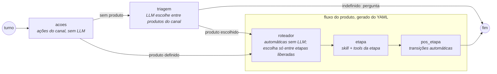
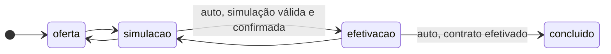
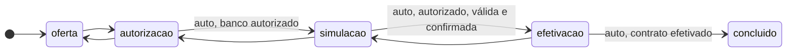

# agent-canais

Esboço de um agente LLM que substitui o orquestrador determinístico dos canais de crédito (app, gerente e operações). Ele chama as APIs que já estão no gateway e é guiado por três coisas declarativas: um catálogo de APIs, que cada time mantém, skills por etapa e um grafo LangGraph (TypeScript) montado a partir de YAML. As regras que não podem falhar ficam em código, como guardas.

A ideia central é simples: **a LLM conduz a conversa e decide a ordem das chamadas onde existe escolha de verdade, e o código garante o que é obrigatório**. Uma skill é instrução, e a LLM segue instrução quase sempre, não sempre. Então a skill faz o fluxo dar certo na grande maioria das conversas, e as guardas pegam os casos em que a LLM erra, transformando o erro numa mensagem que ela mesma corrige em vez de uma contratação indevida.

## Uma conversa de ponta a ponta

O cliente abre o app e escreve "quero fazer um consignado". O nó de **triagem** pede para a LLM escolher o produto, mas só entre os produtos liberados para aquele canal (a saída é um enum). Ela escolhe `consignado`, e o grafo entra no fluxo `credito_padrao` pela etapa `oferta`. Nesse nó, a LLM recebe a política geral, a skill da oferta e **apenas** a tool `consignado__consultarOfertas`. Ela chama a tool, o executor valida os argumentos, injeta o CPF da sessão e chama o gateway com o token do próprio cliente. A oferta volta e fica guardada no estado.

O cliente responde "10 mil em 48 meses". O **roteador** calcula, por código, para onde a conversa pode ir a partir de `oferta`, e a LLM escolhe `simulacao` entre essas opções. No nó de simulação, a única tool disponível é `consignado__simularContrato`. A simulação volta com parcela, taxa e CET, e o canal desenha o **cartão de confirmação** a partir dela, por código, com os campos que o time declarou no manifesto. A LLM só informa a parcela e aponta para o cartão.

O cliente toca em **Confirmar**. Isso não é texto: é uma ação estruturada (`confirmar_simulacao`) que o nó `acoes` grava como confirmação daquela simulação específica. Com as guardas `simulacao_valida` e `confirmacao_do_cliente` verdadeiras, a transição para `efetivacao` é automática, sem consultar a LLM. Lá, a tool de efetivação não tem nenhum argumento para a LLM preencher: o runtime usa a simulação confirmada, manda uma chave de idempotência e consome a confirmação. O contrato é criado e a conversa segue sozinha para `concluido`.

Se em qualquer momento a LLM tentar contratar sem a confirmação, ela recebe de volta "não está disponível nesta etapa" ou "bloqueado: condições não atendidas", e nada sai para o gateway. Os testes em `tests/agente.test.ts` cobrem exatamente esses casos.

## Como o grafo é montado

Cada turno (uma mensagem ou uma ação do canal) percorre o grafo assim:



O fluxo padrão (consignado e crédito pessoal) e o do FGTS, que estende o padrão com a etapa de autorização:





A ordem obrigatória mora nas transições de `fluxos/*.yaml`, nunca numa skill. Ficar na etapa atual é sempre permitido, e uma transição só vira opção quando todas as guardas dela passam. Se há mais de uma opção, a LLM escolhe, mas a saída é um enum com as opções liberadas, então ela não tem como escolher uma transição que o grafo não permite. Se a escolha falhar por qualquer motivo, a conversa fica na etapa atual.

## O que cada time entrega

Um produto novo é uma pasta em `catalogo/<produto>/`, sem nenhuma linha de código. O crédito pessoal (`catalogo/cdc`) entrou assim, reaproveitando o fluxo e as skills padrão.

O `openapi.yaml` é o spec que o time já publica no gateway. Ele é o **contrato**: o runtime gera o schema de cada tool a partir dele (parâmetros de path e query e o corpo JSON, com tipos, limites, enums e obrigatórios) e valida os argumentos da LLM antes de chamar o gateway. Por isso pedir só a collection não basta: ela mostra uma chamada que funcionou, mas não diz que o prazo vai de 6 a 96 meses nem quais campos são obrigatórios. Para o time que ainda não tem spec, `npm run collection` converte a collection num rascunho de OpenAPI, marcado com `x-revisar`, sem copiar os valores de exemplo (que costumam ter CPF e token). O time revisa uma vez e o rascunho vira o contrato. No rascunho, um `valor: 3000` vira `integer`, que é justamente o tipo de coisa que a revisão corrige.

O `manifesto.yaml` é o complemento. Uma parte é escrita para a LLM: `descricao` do produto e, por operação, `quandoUsar`, `quandoNaoUsar` e `exemplos`. Os exemplos podem vir da collection, sem dados pessoais, e são validados contra o schema no boot, então um exemplo desatualizado derruba a subida e não a conversa. A outra parte o runtime aplica em código: a `etapa` em que a tool aparece, o `efeito` (leitura ou escrita), as guardas em `requer`, os parâmetros em `doContexto` que nunca vêm da LLM (como `cpf: sessao.cpf` ou `simulacaoId: dados.confirmacao.simulacaoId`), a chave `produz` onde o resultado fica guardado, os `canais` e o `cartaoConfirmacao`.

As `skills/<etapa>.md` são opcionais e trazem o roteiro do produto em cada etapa. Se o time não escrever uma, vale a de `skills/_padrao`. O nó da etapa carrega a skill certa (produto + etapa), então a LLM nunca vê as skills dos outros produtos.

## O que fica em código e o que fica em texto

Em texto, e portanto sujeito à LLM, ficam o tom do atendimento, quando usar cada tool, como explicar o produto, o que perguntar quando falta informação e a escolha entre etapas liberadas.

Em código, e portanto garantido, ficam:

- quais tools existem em cada etapa e canal (allowlist);
- a validação dos argumentos contra o OpenAPI;
- os parâmetros sensíveis vindos da sessão (a LLM não consegue consultar outro CPF, porque o parâmetro nem existe no schema dela);
- as guardas de negócio;
- a confirmação como ação estruturada vinculada a uma simulação específica, consumida por uma única tentativa de escrita;
- a chave de idempotência nas escritas;
- o cartão com taxa e CET;
- o token do cliente repassado ao gateway;
- as transições obrigatórias do fluxo.

O token e o CPF vivem na `Sessao`, que viaja na config de cada chamada do grafo e não no estado, então não são gravados pelo checkpointer nem enviados para a LLM. As mensagens de tool ficam locais ao turno, e o que importa delas vai para `dados`, que entra no prompt da etapa seguinte.

## Trocar de modelo

O modelo está em `config/runtime.yaml` e passa pelo `initChatModel` do LangChain. Trocar o Claude Sonnet 5.5 pelo Claude Opus 5.5 ou pelo GPT-6 Astra é mudar duas linhas. A escolha deve sair das evals no seu domínio, olhando pass^k, custo e latência. No τ³-Banking, o benchmark público mais próximo deste caso, em novembro de 2026 o Opus 5.5 e o Sonnet 5.5 aparecem praticamente empatados (55,0% e 54,0%), com o GPT-6 Astra em 46,7%. Mesmo o melhor erra perto de metade das tarefas daquele domínio, e é por isso que as garantias ficam em código. Detalhes e fontes em `docs/decisoes.md`.

## Evals e pass^k

`evals/tarefas.yaml` descreve clientes (instruções para um usuário simulado por LLM) e o **estado final esperado** do banco, ou seja, os contratos criados no gateway mock. A avaliação não julga o texto da conversa, só o resultado, como no τ-bench. Cada tarefa roda k vezes, e o relatório mostra o pass^k: a chance de o agente acertar a mesma tarefa em todas as k tentativas. A média diz quão bom o agente é, e o pass^k diz quão confiável ele é. Num canal com milhares de conversas por dia, é o segundo número que importa.

Editar uma skill, um manifesto ou um fluxo muda o comportamento do canal em produção, então tem o peso de um deploy. Rode as evals antes de publicar qualquer alteração.

## Rodando

```bash
npm install
npm test                 # 30 testes sem rede e sem LLM (modelo roteirizado + gateway mock)
npm run typecheck

export ANTHROPIC_API_KEY=...   # ou OPENAI_API_KEY, conforme o config
npm run chat -- --canal mobile --cpf 12345678901
npm run chat -- --canal mobile --cpf 12345678900 --fgts-pendente
npm run chat -- --gateway-real            # usa gateway.urlBase do config e TOKEN_CLIENTE do ambiente
npm run evals -- --k 4
npm run collection -- colecao.json --base-path /credito/cdc/v1 --saida catalogo/cdc/openapi.yaml
```

No chat, `/confirmar` faz o papel do botão "Confirmar" do cartão, e `/estado` mostra produto, etapa e dados.

## Estrutura

```
catalogo/<produto>/      o que cada time entrega: openapi.yaml, manifesto.yaml, skills/
fluxos/                  grafos declarativos (credito_padrao, fgts estende o padrão)
skills/_comum            política geral e triagem
skills/_padrao           roteiro padrão de cada etapa
config/runtime.yaml      modelo, gateway, limites e avaliação
src/catalogo.ts          OpenAPI + manifesto -> tools (schema, descrição, regras)
src/executor.ts          allowlist, validação, guardas, contexto, idempotência, chamada ao gateway
src/guardas.ts           regras de negócio em código
src/fluxo.ts             carga dos fluxos YAML e cálculo das transições liberadas
src/agente.ts            montagem do grafo LangGraph (acoes, triagem, roteador, etapas, pos_etapa)
src/gateway.ts           chamada HTTP com o token do cliente
src/apresentacao.ts      cartão de confirmação gerado por código
src/modelo.ts            adaptador de LLM (qualquer provedor do LangChain)
src/collection.ts        collection do Postman -> rascunho de OpenAPI
src/mockGateway.ts       APIs falsas de consignado, crédito pessoal e FGTS
evals/                   tarefas e executor de evals com pass^k
tests/                   testes sem rede, com modelo roteirizado
docs/decisoes.md         as decisões de arquitetura e o porquê de cada uma
```

## Próximos passos

O fluxo de pós-venda (listar contratos, quitar, antecipar parcelas e cancelar) entra como um novo fluxo YAML e novas operações nos manifestos, com guardas próprias, como prazo de arrependimento para cancelar. Para produção, entram também:

- um checkpointer persistente (Redis ou DynamoDB) no lugar do `MemorySaver`;
- observabilidade com Langfuse, ligando o `rastro` de cada turno aos traces;
- um modelo mais barato só para triagem e roteamento;
- troca de produto no meio da conversa;
- suporte a `$ref` externas no OpenAPI;
- autenticação específica dos canais gerente e operações, em que o token não é do cliente.
